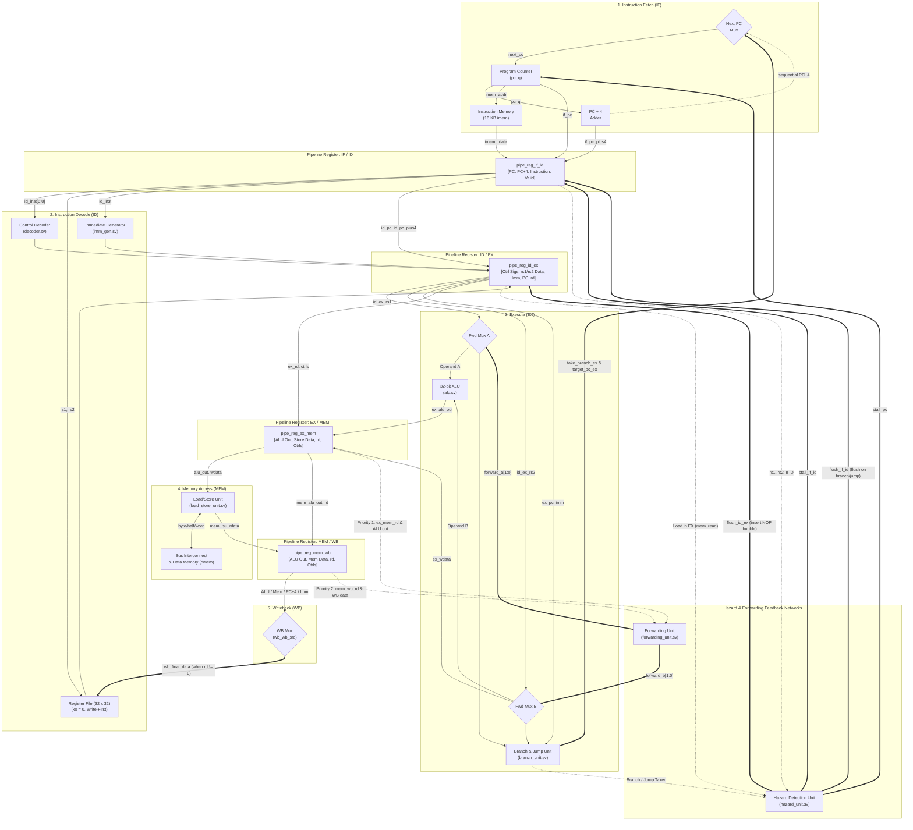

# Standalone 5-Stage Pipelined RV32I Processor

> **Hardware Disclaimer**  
> *This project was developed and validated entirely using software-based RTL simulation and FPGA toolchain flows (SystemVerilog, Icarus Verilog v12.0, Python 3.13, and AMD/Xilinx Vivado v2026.1). No physical FPGA development board was used for hardware testing.*

A 32-bit RISC-V (RV32I) 5-stage pipelined processor core designed in SystemVerilog, verified with directed and randomized testbenches against an independent Python architectural reference, and implemented for an AMD Artix-7 FPGA using Vivado 2026.1.

---

## 1. Project Overview & Motivation

### What I Built
I designed, verified, and physically implemented a standalone 32-bit RISC-V processor implementing the unprivileged **RV32I Base Integer Instruction Set** (37 instructions). The core features:
- A textbook 5-stage in-order pipeline: **Instruction Fetch (IF)**, **Instruction Decode (ID)**, **Execute (EX)**, **Memory Access (MEM)**, and **Writeback (WB)**.
- Full data forwarding logic (**EX/MEM** and **MEM/WB**) to resolve Read-After-Write (RAW) data hazards.
- Automated hazard interlocks handling load-use stalls (1-cycle bubble insertion) and branch/jump flushes (exact 2-cycle penalty).
- Dual 16 KB Harvard memories (`imem` and `dmem`) with byte, halfword, and word access formatting.
- Memory-mapped peripherals including a host communication mailbox, character debug output (UART Lite), and a 64-bit cycle timer / Hardware Performance Monitoring Unit (HPMU).
- A synthesizable physical FPGA top wrapper (`cpu_fpga_top`) featuring a 2-stage reset synchronizer, a 26-bit clock divider heartbeat LED, an autonomous power-on self-test (POST) controller, and a 17-pin physical interface.

### Why I Built It
As a second-year BTech student interested in digital VLSI design, computer architecture, and RTL verification, I built this project to move beyond textbook diagrams and understand how processors behave in actual hardware:
- How pipeline hazard interlocks, stalls, and bypass multiplexers interact under corner-case instruction sequences.
- How memory access semantics dictate FPGA hardware primitive selection (Distributed RAM vs. Block RAM).
- How to achieve static timing closure at 100 MHz on an actual FPGA technology target (`xc7a100tcsg324-1`) using AMD Vivado.
- How to structure a rigorous verification flow combining directed testbenches, assembly self-tests, and constrained-randomized testing against an independent Python reference model.

---

## 2. Processor Architecture & Five-Stage Pipeline

### 2.1 Pipelined Datapath & Control Architecture

The processor implements a classic 5-stage in-order RISC pipeline with synchronized stage registers, combinational forwarding multiplexers, and an integrated hazard detection interlock unit.



### 2.2 Pipeline Stage Walkthrough & Control Interaction

1. **Instruction Fetch (IF)**:
   - Maintains the 32-bit Program Counter (`pc_q`). The next PC multiplexer selects between sequential $PC + 4$, branch/jump targets from the EX stage (`target_pc_ex`), or freezes the current PC when stalled (`stall_pc`).
   - Instruction memory (`imem`) performs a single-cycle combinational read, passing instruction word and fetch metadata to `pipe_reg_if_id` on each rising clock edge.
2. **Instruction Decode (ID)**:
   - Decodes opcode, format types, register source/dest numbers (`rs1`, `rs2`, `rd`), and ALU/memory control signals.
   - Dual-read register file (`regfile.sv`) outputs source register contents combinationally. Register `x0` is hardwired to 0. An internal write-first bypass returns current-cycle write data if reading the destination register being committed in WB.
   - Sign-extends immediates across all 5 RV32I formats (I, S, B, U, J) via `imm_gen.sv`.
3. **Execute (EX)**:
   - Evaluates arithmetic, boolean logic, and shift operations in the 32-bit ALU (`alu.sv`).
   - Branch comparator (`branch_unit.sv`) evaluates branch comparisons (signed/unsigned equality and magnitude) and calculates branch/jump targets (`target_pc_ex = ex_pc + imm` or `ex_rs1 + imm` for JALR).
   - Forwarding multiplexers select between the decoded register data and forwarded values from downstream stages.
4. **Memory Access (MEM)**:
   - Dedicated Load/Store Unit (`load_store_unit.sv`) aligns byte and halfword store data with appropriate byte write strobes (`dmem_wstrb[3:0]`), and handles sign-extension or zero-extension for loads (LB, LBU, LH, LHU, LW).
   - Routes accesses across the memory bus (`bus_interconnect.sv`) to local data memory (`dmem`) or peripheral addresses.
5. **Writeback (WB)**:
   - Final multiplexer selects commit data from the ALU output, memory load data, $PC + 4$ (for JAL/JALR link register saving), or immediate data (for LUI).
   - On the rising clock edge, if `wb_reg_write` is active and $rd \neq 0$, the selected value is written to the register file.

### 2.3 Interaction of Forwarding & Hazard Interlocks

* **Resolving RAW Hazards via Forwarding:** When an instruction in EX requires a register written by an instruction in MEM or WB, `forwarding_unit.sv` bypasses the register file without stalling:
  - **Priority 1 (EX-to-EX):** Forwarded from the immediate prior instruction in MEM (`mem_fwd_data`).
  - **Priority 2 (MEM-to-EX):** Forwarded from the WB commit stage (`wb_final_data`) if not superseded by Priority 1.
* **Resolving Load-Use Hazards via Interlocks:** Because load data from memory is not available until the end of the MEM stage, an instruction in ID needing a load result from EX cannot be satisfied by forwarding. The `hazard_unit.sv` detects `ex_mem_read && (ex_rd == id_rs1 || ex_rd == id_rs2)`:
  - Freezes `pc_q` (`stall_pc = 1`) and the IF/ID register (`stall_if_id = 1`).
  - Clears control signals in `pipe_reg_id_ex` (`flush_id_ex = 1`), injecting a single-cycle NOP bubble into EX.
  - In the next clock cycle, the load advances to MEM, where normal Priority 1 forwarding routes the memory data to EX.
* **Control Hazards on Taken Branches & Jumps:**
  - Branch condition and target calculations resolve in the EX stage.
  - When taken (`take_branch_ex = 1`), both instructions currently fetched speculatively into IF/ID and ID/EX are purged (`flush_if_id = 1`, `flush_id_ex = 1`).
  - Next cycle, the target address is fetched into IF, resulting in an exact **2-cycle penalty**. Non-taken branches incur zero penalty.

---

## 3. Supported ISA & Mathematical Operations

### 3.1 Supported RV32I Base Integer Instructions (37 Instructions)
- **Computational (Register-Immediate)**: `ADDI`, `SLTI`, `SLTIU`, `XORI`, `ORI`, `ANDI`, `SLLI`, `SRLI`, `SRAI`
- **Computational (Register-Register)**: `ADD`, `SUB`, `SLL`, `SLT`, `SLTU`, `XOR`, `SRL`, `SRA`, `OR`, `AND`
- **Upper Immediate**: `LUI`, `AUIPC`
- **Unconditional Jumps**: `JAL`, `JALR`
- **Conditional Branches**: `BEQ`, `BNE`, `BLT`, `BGE`, `BLTU`, `BGEU`
- **Load Instructions**: `LB`, `LH`, `LW`, `LBU`, `LHU`
- **Store Instructions**: `SB`, `SH`, `SW`
- **Environment & System**: `ECALL`, `EBREAK`, `FENCE` (decoded as safe non-trapping instructions in standalone configuration)

### 3.2 Software Multiplication and Division
The standalone core implements pure RV32I integer hardware. Mathematical multiplication and division are executed through assembly subroutines running on the integer datapath:
- **Multiplication**: 32-step signed iterative shift-and-add algorithm (`mul_core` in `interactive_cpu.s`).
- **Division / Remainder**: 32-step restoring division algorithm (`div_core` in `interactive_cpu.s`) with deterministic handling of division-by-zero ($Q=-1, R=\text{numerator}$) and signed overflow ($\text{INT\_MIN} / -1 = \text{INT\_MIN}$).

---

## 4. Memory Architecture & Hardware Mapping

### 4.1 Memory Map Summary
| Address Range | Size | Component | Function |
| :--- | :---: | :--- | :--- |
| `0x0000_0000 - 0x0000_3FFF` | 16 KB | `imem` | Harvard Instruction Memory |
| `0x0000_4000 - 0x0000_7FFF` | 16 KB | `dmem` | Harvard Data Memory |
| `0x8000_0000 - 0x8000_001F` | 32 B  | `host_interface` | Host Mailbox / Control Registers |
| `0x8000_0020 - 0x8000_003F` | 32 B  | `timer` | 64-bit Cycle Counter & HPMU |
| `0x8000_0040 - 0x8000_005F` | 32 B  | `uart_lite` | Debug Character Output |

### 4.2 Distributed RAM Mapping Rationale
In Vivado synthesis, `imem` and `dmem` infer as **Distributed RAM (LUT RAM: 2,292 LUTs)** rather than Block RAM (BRAM):
- **Technical Reason**: AMD 7-series Block RAM primitives (`RAMB36E1`) require synchronous registered reads (`always_ff @(posedge clk)`), enforcing a mandatory 1-cycle read latency.
- In contrast, the classic 5-stage pipeline presents addresses and samples read data within the same clock period (`assign rdata = mem[...]`).
- Converting memories to Block RAM would convert the pipeline into a 6- or 7-stage microarchitecture (introducing IF1/IF2 and MEM1/MEM2 stages) with increased branch penalties and forwarding multiplexers.
- Distributed RAM (utilizing Artix-7 SLICEM LUTs configured as `RAM256X1S` and `RAM64M`) preserves 5-stage architectural simplicity, consumes 12.06% of device LUTRAM, and cleanly closes timing at 100 MHz (+0.178 ns WNS post-route).

---

## 5. Measured FPGA Implementation & Timing Results

Measurements extracted directly from fresh AMD Vivado v2026.1 (64-bit) runs on the **Artix-7 100T FPGA (`xc7a100tcsg324-1`)** at a **100.00 MHz (10.000 ns)** constraint:

| Implementation Metric | Synthesis Stage | Post-Route Signoff | Device Capacity (`xc7a100tcsg324-1`) | Device Utilization | Status |
| :--- | :---: | :---: | :---: | :---: | :---: |
| **Top-Level Module** | `cpu_fpga_top` | `cpu_fpga_top` | — | — | Clean |
| **Target Clock Frequency** | 100.0 MHz (10.0 ns) | 100.0 MHz (10.0 ns) | — | — | Signoff Target |
| **Implementation Status** | **Passed (0 Errors)** | **Passed (0 Errors)** | — | — | **100% Success** |
| **Slice LUTs** | 4,863 | **4,834** | 63,400 | **7.62 %** | Clean |
| ├── LUT as Logic | 2,571 | **2,542** | 63,400 | **4.01 %** | Clean |
| └── LUT as Distributed RAM | 2,292 | **2,292** | 19,000 | **12.06 %** | Clean |
| **Slice Registers (FFs)** | 2,177 | **2,051** | 126,800 | **1.62 %** | Clean |
| ├── Flip-Flops | 2,177 | **2,051** | 126,800 | **1.62 %** | Clean |
| └── Latches | 0 | **0** | 126,800 | **0.00 %** | **0 Latches** |
| **Block RAM (BRAM Tiles)** | 0 | **0** | 135 | **0.00 %** | Clean |
| **DSP Blocks (DSP48E1)** | 0 | **0** | 240 | **0.00 %** | Clean |
| **Top-Level Physical Pins (IOB)**| 17 | **17** | 210 User Pins | **8.10 %** | `IOCNT-1` Resolved |
| **Global Clock Buffers (BUFG)**| 1 | **1** | 32 | **3.13 %** | Clean |
| **Worst Negative Slack (WNS)** | **+0.787 ns** | **+0.178 ns** | $\ge 0.0$ ns | — | **TIMING MET** |
| **Total Negative Slack (TNS)** | **0.000 ns** | **0.000 ns** | $0.0$ ns | — | **TIMING MET** |
| **Worst Hold Slack (WHS)** | **+0.131 ns** | **+0.159 ns** | $\ge 0.0$ ns | — | **TIMING MET** |
| **Total Hold Slack (THS)** | **0.000 ns** | **0.000 ns** | $0.0$ ns | — | **TIMING MET** |
| **Worst Pulse Width (WPWS)** | **+3.000 ns** | **+3.000 ns** | $\ge 0.0$ ns | — | **TIMING MET** |
| **Achieved Clock Frequency** | 108.54 MHz | **101.81 MHz** | Target: 100.0 MHz | — | **Timing Closed** |
| **Net Routing Status** | — | **100% Routed** | 4,956 / 4,956 Nets | — | **0 Errors** |
| **Bitstream Generation** | — | **Generated (3.65 MB)**| `cpu_fpga_top.bit` | — | **0 Errors** |

---

## 6. What I Learned During Development

1. **Forwarding Priority Matters**: If an instruction in the MEM stage writes to register `x1` and an instruction in the WB stage also writes to register `x1`, the EX stage must forward from EX/MEM, not MEM/WB. Reversing or omitting priority checks causes stale register reads.
2. **Multi-Cycle Bus Stalls Require Flushing the Writeback Stage**: When a memory transaction asserts `dmem_stall`, stalling the earlier stages (`pc`, `if_id`, `id_ex`, `ex_mem`) without flushing `mem_wb` causes the instruction in MEM to be repeatedly latched and retired into the register file every stall cycle. Connecting `flush_mem_wb = dmem_stall` resolved this critical issue.
3. **FPGA Memory Architecture Trade-Offs**: Realizing why Block RAM cannot be used combinationally without changing the pipeline was an important lesson in hardware design. The choice to use distributed LUT RAM was deliberate to keep the classic 5-stage pipeline behavior intact while still meeting 100 MHz timing.
4. **Physical Pin Limits on FPGAs**: Testbenches frequently expose hundreds of internal signals for monitoring (291 ports). Attempting to synthesize that directly triggers Vivado DRC `IOCNT-1`. Wrapping the design in `cpu_fpga_top` with multiplexed outputs and an autonomous state machine reduced physical pins to 17.

---

## 7. Verification Methodology & Results

### 7.1 Test Summary Table

| Verification Suite | Test Environment | Tests Run | Passed | Failed | Status |
| :--- | :--- | :---: | :---: | :---: | :---: |
| **Directed Arithmetic & Logic** | `tb_cpu_interactive.sv` | 15 | 15 | 0 | **PASS** |
| **Full 37-Instruction RV32I ISA** | `interactive_cpu.s` (`CMD=14`) | 1 | 1 | 0 | **PASS** |
| **Randomized Golden Model Tests** | `run_interactive_cpu.py` (Seed: 42) | 50 | 50 | 0 | **PASS** |
| **FPGA Wrapper Smoke Test** | `tb_cpu_fpga_top.sv` | 2 | 2 | 0 | **PASS** |
| **Autonomous Boot Firmware** | `standalone_boot.s` | 1 | 1 | 0 | **PASS** |
| **Total Verified Standalone Tests**| — | **69** | **69** | **0** | **100% PASS** |

### 7.2 Key Verification Benchmarks
1. **Full 37-Instruction ISA Suite**: Case 14 of `interactive_cpu.s` verifies every base instruction sequentially in **249 clock cycles**, returning `Status = 0x50415353` ("PASS") and `Result = 37`.
2. **50 Constrained-Randomized Vectors**: Inputs biased with 40% corner cases (`0`, `1`, `-1`, `INT_MIN`, `INT_MAX`, `0x55555555`, `0xAAAAAAAA`, `0xFFFFFFFF`) verified bit-by-bit against `python_reference()`.
3. **FPGA Wrapper Smoke Test**:
   - Mode 00: Autonomous execution of 37-instruction ISA suite upon reset release, completing in 303 clock cycles with `led_pass = 1` and `led = 37`.
   - Mode 01: Button-triggered execution of addition (`25 + 17`), completing in 37 clock cycles with `led_pass = 1` and `led = 42`.
4. **Autonomous Boot Firmware**: Standalone 62-instruction assembly boot program (`standalone_boot.s`) executes in **88 clock cycles**, calculating $\sum_{i=1}^{10} i = 55$.

---

## 8. Project Directory Structure

```text
RISC-V/
├── .gitignore                     # Git exclusion rules for intermediate artifacts
├── README.md                      # Primary project portfolio documentation
├── docs/                          # Comprehensive technical reports
│   ├── ARCHITECTURE.md            # Detailed microarchitectural specification
│   ├── BUILD_AND_RUN.md           # Step-by-step build, simulation, and execution guide
│   ├── CHANGELOG.md               # Engineering version history and changelog
│   ├── FPGA_AUDIT_REPORT.md       # Comprehensive Vivado implementation audit
│   ├── FPGA_READINESS.md          # Hardware readiness and pinout recommendations
│   ├── KNOWN_LIMITATIONS.md       # Architectural boundaries and hardware scope
│   ├── MEMORY_MAP.md              # Global physical memory map
│   ├── PERFORMANCE_REPORT.md      # Hardware cycle profiling and timing report
│   ├── REGISTER_MAP.md            # Peripheral bit-level register descriptions
│   ├── VERIFICATION.md            # Verification strategy and test descriptions
│   └── VERIFICATION_REPORT.md     # Detailed verification pass/fail breakdown
├── fpga/                          # Vivado synthesis & implementation workflow
│   ├── README.md                  # FPGA implementation guide
│   ├── constraints/clock.xdc      # 100 MHz timing and configuration constraints
│   ├── scripts/                   # Non-project batch Tcl flow
│   │   ├── run_synthesis.tcl      # Synthesis Tcl script
│   │   ├── run_implementation.tcl # Placement and routing Tcl script
│   │   └── run_bitstream.tcl      # Bitstream generation evaluation script
│   ├── checkpoints/               # Bitstream file (cpu_fpga_top.bit)
│   ├── reports/                   # Human-readable Vivado utilization, timing, and DRC reports
│   ├── run_synthesis.ps1          # Automated PowerShell synthesis runner
│   ├── run_implementation.ps1     # Automated PowerShell implementation runner
│   └── run_bitstream.ps1          # Automated PowerShell bitstream runner
├── rtl/                           # Synthesizable SystemVerilog source code
│   ├── core/                      # Processor datapath, pipeline registers, ALU, hazard logic
│   ├── interconnect/              # Memory-mapped bus interconnect
│   ├── memory/                    # Instruction and data memory modules
│   ├── peripherals/               # Host interface, timer/HPMU, UART Lite
│   └── soc/                       # cpu_fpga_top (physical wrapper) and cpu_standalone_top
├── scripts/                       # Regression and simulation automation
│   ├── run_cpu_regression.ps1     # Standalone CPU regression runner (66 tests)
│   ├── run_fpga_smoke_test.ps1    # FPGA wrapper smoke test runner
│   ├── run_interactive_cpu.py     # Interactive CPU test and golden model validator
│   └── run_all_regressions.py     # Multi-mode master regression runner
├── software/                      # Assembly programs and toolchain
│   ├── asm/                       # interactive_cpu.s and standalone_boot.s
│   └── assembler/                 # Python-based RISC-V two-pass assembler
├── tb/                            # Simulation testbenches
│   └── cpu/                       # tb_cpu_interactive.sv and tb_cpu_fpga_top.sv
└── verification/final/            # Formal pre-GitHub verification signoff deliverables
    ├── FINAL_ACCEPTANCE_CHECKLIST.md
    ├── FINAL_COMPLETION_REPORT.md
    ├── FINAL_DOCUMENTATION_AUDIT.md
    ├── FINAL_TEST_REPORT.md
    ├── FINAL_VIVADO_REPORT.md
    └── GITHUB_READINESS_REPORT.md
```

---

## 9. Prerequisites & Windows Setup Instructions

### 9.1 Required Software
- **Python 3.10+** (tested with Python 3.13)
- **Icarus Verilog (`iverilog` & `vvp`) v12.0+**
- **AMD/Xilinx Vivado Design Suite 2022+** (tested with v2026.1)
- **PowerShell 5.1+ or PowerShell Core 7+**

### 9.2 Environment Configuration
Ensure `python`, `iverilog`, `vvp`, and `vivado` are present on your Windows `PATH`:
```powershell
python --version
iverilog -v
vvp -v
vivado -version
```

---

## 10. Reproduction Commands

All commands execute cleanly in PowerShell from the `RISC-V` directory:

```powershell
Set-Location "PP/RISC-V"

# 1. Run Standalone CPU Hardware Regression (66 tests)
.\scripts\run_cpu_regression.ps1

# 2. Run FPGA Top-Level Wrapper Smoke Test (2 tests)
.\scripts\run_fpga_smoke_test.ps1

# 3. Run Vivado Batch Synthesis (xc7a100tcsg324-1, 100 MHz target)
Set-Location fpga
.\run_synthesis.ps1

# 4. Run Vivado Batch Physical Implementation (Opt, Place, Phys-Opt, Route)
.\run_implementation.ps1

# 5. Run Vivado Bitstream Generation Evaluation
.\run_bitstream.ps1
```

---

## 11. Known Limitations & Future Improvements

1. **Board Pin Binding & Physical Testing**:
   The FPGA implementation targets generic `xc7a100tcsg324-1`. Bitstream generation was formally verified in Vivado 2026.1 using documented DRC severity overrides (`NSTD-1`, `UCIO-1`), generating `cpu_fpga_top.bit` (3,825,992 bytes). However, physical programming and board-level hardware testing are explicitly not performed as no physical board is owned or used. To deploy on physical hardware (e.g. Digilent Nexys A7-100T), map `cpu_fpga_top`'s 17 ports to the board master XDC.
2. **Synchronous Block RAM Migration**:
   Migrating `imem` and `dmem` from distributed RAM to dedicated BRAM primitives will save ~2,292 LUTs but requires restructuring the instruction fetch and memory access stages to absorb the 1-cycle BRAM synchronous read latency.
3. **Hardware Multiplier/Divider (RV32M)**:
   Future revisions can incorporate single-cycle DSP-based multipliers (`MUL`, `MULH`, `MULHSU`, `MULHU`) and multi-cycle iterative divider units (`DIV`, `DIVU`, `REM`, `REMU`) to accelerate mathematical subroutines.

---

## 12. References & Attribution

The architecture, pipeline control, and verification methodology of this processor were informed by the design principles and reference structures in the following open-source repositories:
- **[OnMason/RV32I-Pipelined-Processor](https://github.com/OnMason/RV32I-Pipelined-Processor)**: 5-stage RV32I pipeline structure, EX/MEM and MEM/WB forwarding priorities, load-use hazard detection, branch flushing, and golden model verification.
- **[cshieldsce/riscv-5i](https://github.com/cshieldsce/riscv-5i)**: Synthesizable top-level integration patterns, FPGA implementation scripts, and timing closure methodologies on Xilinx FPGAs.
